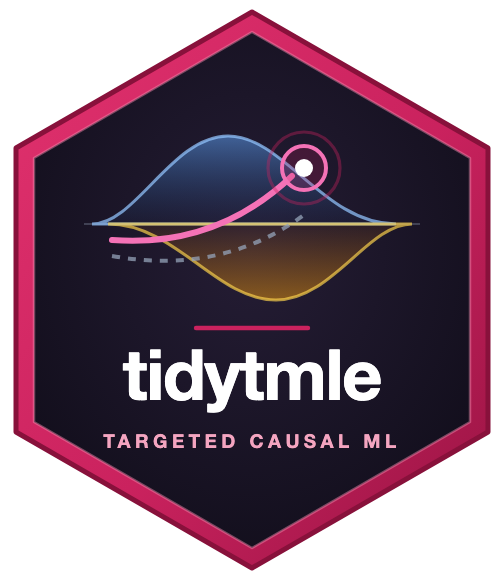

<!-- README.md is generated from README.Rmd. Please edit that file -->

```{r, include = FALSE}
knitr::opts_chunk$set(
  collapse = TRUE,
  comment = "#>",
  fig.path = "man/figures/README-",
  fig.cap = "",
  out.width = "100%"
)
```

# tidytmle <a href="https://perceptioninterval.github.io/tidytmle/"></a>

<!-- badges: start -->
[](https://lifecycle.r-lib.org/articles/stages.html#experimental)
[](https://CRAN.R-project.org/package=tidytmle)
[](https://github.com/perceptioninterval/tidytmle/actions/workflows/R-CMD-check.yaml)
<!-- badges: end -->

`tidytmle` brings **Targeted Maximum Likelihood Estimation (CV-TMLE)** to the [tidymodels](https://www.tidymodels.org/) ecosystem. Rather than forcing causal estimation into a prediction-only `parsnip` model, `tidytmle` orchestrates `workflows`, `workflowsets`, `recipes`, `rsample`, `hardhat`, and `yardstick` so you can plug any machine learning pipeline into a doubly robust, locally efficient causal estimator.

## Which Function Do I Need?

| What you want to do | One-line `tidytmle` call |
|---|---|
| Estimate ATE, Risk Ratio, & Odds Ratio safely | `tmle_spec(y, a, c(age, sex, lab_1), estimand = c("ate", "rr", "or")) \|> fit(df)` |
| Handle missing outcomes automatically | Omit `censoring` when `y` has `NA`s (or pass `censoring = delta`) |
| Plug in a custom `workflow_set` Super Learner | `set_outcome_learners(wf_set) \|> set_treatment_learners(wf_set)` |
| Account for clinic clusters or survey weights | Pass `id = clinic_id` and `weights = survey_wt` inside `tmle_spec()` |
| Read a plain-English interpretation & health audit | `summary(fit)` or `explain_tmle(fit)` |
| Test stricter positivity bounds or subgroups instantly | `retarget(fit, g_bounds = c(0.05, 0.95), subgroup = age >= 65)` |
| Inspect a 4-panel visual audit dashboard | `autoplot(fit, type = "dashboard")` |
| Shift a continuous dose without extrapolating | `tmle_spec(y, dose, c(...), estimand = shift(1.0)) \|> fit(df)` |
| Estimate heterogeneous treatment effects (CATE) | `fit_cate(fit)` then `predict(cate, new_data)` or `qini_auc(cate)` |

## Why TMLE? The 60-Second Intuition

Standard machine learning regression (**G-computation**) minimizes *global* prediction error rather than the bias-variance trade-off for a causal treatment effect—leaving residual confounding bias and invalid confidence intervals. Conversely, **inverse-probability weighting (IPTW)** discards outcome modeling and blows up in variance whenever propensity scores approach `0` or `1` (*positivity violations*).

**TMLE resolves both weaknesses with a simple two-stage philosophy: *"Predict, Then Target."*** (Schuler & Rose, 2017; Luque-Fernandez et al., 2018; van der Laan & Rubin, 2006):

| Estimator | What It Models | Key Trade-off |
|---|---|---|
| **G-Computation** | Outcome $\bar{Q}^0(A, W) = E[Y \mid A, W]$ | Optimizing global outcome accuracy leaves slow-converging bias in causal contrasts. |
| **IPTW Weighting** | Propensity $g(W) = P(A = 1 \mid W)$ | Ignores outcome structure; unstable variance when $g(W)$ is near `0` or `1`. |
| **Targeted MLE (`tidytmle`)** | **Both** $\bar{Q}^0(A, W)$ and $g(W)$, then *fluctuates* $\bar{Q}^0 \mapsto \bar{Q}^*$ | **Doubly robust** (consistent if *either* model is right), **locally efficient**, and **bounded** inside natural outcome limits. |

## The 5-Step TMLE Recipe & Decoder Ring

Every TMLE fit executes five concrete steps mapped cleanly to `augment(fit)` and `glance(fit)` columns:

| Step | What Happens Under the Hood | `tidytmle` Columns |
|---|---|---|
| **1. Initial Outcome Fit ($\bar{Q}^0$)** | Cross-validated Super Learner predicts counterfactual outcomes under treatment and control. | `.q1_init`, `.q0_init` |
| **2. Propensity Fit ($g$)** | Classification Super Learner estimates $P(A = 1 \mid W)$ (strictly excluding $A$ and $Y$ from predictors) and applies adaptive bounds. | `.g_hat`, `.g_trunc`, `pct_truncated` |
| **3. Clever Covariate ($H$)** | Constructs $H_n(A, W) = \frac{A}{g_n(W)} - \frac{1-A}{1-g_n(W)}$ from the Efficient Influence Function (EIF) to spotlight potential confounding bias. | `.clever_h` |
| **4. Fluctuation ($\epsilon$)** | Runs a 1-parameter logistic regression of $Y$ on $H_n$ with $\text{logit}(\bar{Q}^0)$ as offset, nudging predictions along the optimal bias-removal path. | `epsilon`, `.q1_star`, `.q0_star`, `plugin_vs_tmle_shift` |
| **5. Substitution & EIF Inference** | Averages targeted counterfactuals and computes asymptotic SEs from the EIF variance (`mean_eif` must be $\approx 0$). | `.eif`, `.eif_leverage`, `mean_eif` |

For a full worked visual walkthrough—including a live demonstration of **double robustness**—read [TMLE Intuition: A Step-by-Step Visual Guide](articles/tmle-intuition.html) (or `vignette("tmle-intuition", package = "tidytmle")`).

## Installation

You can install the development version of `tidytmle` from [GitHub](https://github.com/perceptioninterval/tidytmle) with:

``` r
# install.packages("pak")
pak::pak("perceptioninterval/tidytmle")
```

## Example

Start with a 3-line cross-fitted specification using `tidyselect` causal roles and simultaneous multi-estimand inference, then call `summary(fit)` for a plain-English causal interpretation and health check:

```{r example, message = FALSE, fig.width = 7, fig.height = 4.2, fig.alt = "Mirrored propensity score overlap plot generated by autoplot(fit, type = 'overlap')"}
library(tidytmle)

df <- sim_causal_cohort(n = 350, outcome_type = "binary", seed = 42)

fit <- tmle_spec(
  outcome    = y,
  treatment  = a,
  covariates = c(age, sex, starts_with("lab_")),
  estimand   = c("ate", "rr", "or")
) |>
  set_resamples(v_folds = 5L) |>
  fit(data = df)

summary(fit)

# Simultaneous uniform confidence bands & VanderWeele-Ding E-values
tidy(fit, simultaneous = TRUE, e_value = TRUE)

# Instant retargeting without ML refitting
retarget(fit, g_bounds = c(0.05, 0.95)) |>
  tidy()

# Propensity overlap diagnostic: check positivity across treated & control arms
autoplot(fit, type = "overlap")
```

Inspect how much the fluctuation step adjusted initial G-computation predictions—or view all four visual causal checks together in a single 2×2 dashboard—using `autoplot()`:

```{r targeting-example, message = FALSE, fig.width = 9.5, fig.height = 6.8, fig.alt = "4-panel TMLE Causal Audit Dashboard showing propensity overlap, targeting step contrasts, positivity sensitivity sweep, and covariate balance Love plot"}
autoplot(fit, type = "dashboard", g_grid = seq(0.01, 0.12, by = 0.02))
```

## Foundational Literature

* van der Laan, M. J., & Rubin, D. (2006). Targeted maximum likelihood learning. *Int. J. Biostat.*, 2(1).
* Gruber, S., & van der Laan, M. J. (2010). A targeted maximum likelihood estimator of a causal effect on a bounded continuous outcome. *Int. J. Biostat.*, 6(1).
* Zheng, W., & van der Laan, M. J. (2011). Cross-validated targeted minimum-loss-based estimation. *Targeted Learning*, Springer.
* Petersen, M. L., et al. (2012). Diagnosing and responding to violations in the positivity assumption. *Stat. Methods Med. Res.*, 21(1), 31–54.
* Schuler, M. S., & Rose, S. (2017). Targeted maximum likelihood estimation for causal inference in observational studies. *Am. J. Epidemiol.*, 185(1), 65–73.
* Luque-Fernandez, M. A., et al. (2018). Targeted maximum likelihood estimation for a binary treatment: A tutorial. *Stat. Med.*, 37(16), 2530–2546.
* Díaz, I., Williams, N., Hoffman, K. L., & Schenck, E. J. (2021). Nonparametric causal effects based on longitudinal modified treatment policies. *JASA*, 118(542), 846–857.
* Kennedy, E. H. (2023). Towards optimal doubly robust estimation of heterogeneous causal effects. *Electron. J. Stat.*, 17(2), 3008–3049.

## Code of Conduct

Please note that the `tidytmle` project is released with a [Contributor Code of Conduct](https://contributor-covenant.org/version/2/0/CODE_OF_CONDUCT.html). By contributing to this project, you agree to abide by its terms.
