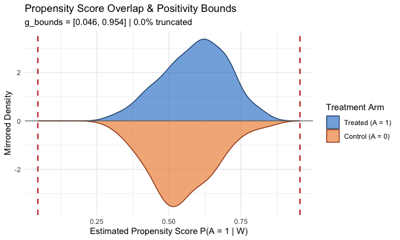
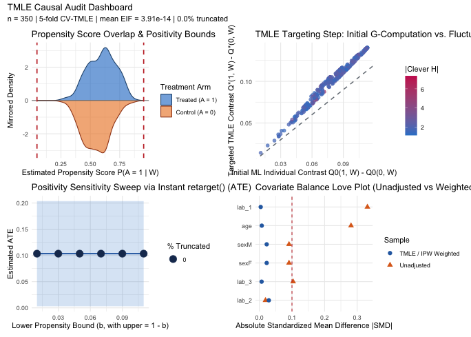

<!-- README.md is generated from README.Rmd. Please edit that file -->


# tidytmle <a href="https://tidytmle.tidymodels.org/"></a>

<!-- badges: start -->
[](https://lifecycle.r-lib.org/articles/stages.html#experimental)
[](https://CRAN.R-project.org/package=tidytmle)
[](https://github.com/michaelespero/tidytmle/actions)
<!-- badges: end -->

`tidytmle` brings **Targeted Maximum Likelihood Estimation (CV-TMLE)** to the [tidymodels](https://www.tidymodels.org/) ecosystem. Rather than forcing causal estimation into a prediction-only `parsnip` model, `tidytmle` orchestrates `workflows`, `workflowsets`, `recipes`, `rsample`, `hardhat`, and `yardstick` so you can plug any machine learning pipeline into a doubly robust, locally efficient causal estimator.

## Why TMLE? The 60-Second Intuition

Standard machine learning regression (**G-computation**) minimizes *global* prediction error rather than the bias-variance trade-off for a causal treatment effect—leaving residual confounding bias and invalid confidence intervals. Conversely, **inverse-probability weighting (IPTW)** discards outcome modeling and blows up in variance whenever propensity scores approach `0` or `1` (*positivity violations*).

**TMLE resolves both weaknesses with a simple two-stage philosophy: *"Predict, Then Target."*** (Schuler & Rose, 2017; Luque-Fernandez et al., 2018; van der Laan & Rubin, 2006):

| Estimator | What It Models | Key Trade-off |
|---|---|---|
| **G-Computation** | Outcome $\bar{Q}^0(A, W) = E[Y \mid A, W]$ | Optimizing global outcome accuracy leaves slow-converging bias in causal contrasts. |
| **IPTW Weighting** | Propensity $g(W) = P(A = 1 \mid W)$ | Ignores outcome structure; unstable variance when $g(W)$ is near `0` or `1`. |
| **Targeted MLE (`tidytmle`)** | **Both** $\bar{Q}^0(A, W)$ and $g(W)$, then *fluctuates* $\bar{Q}^0 \mapsto \bar{Q}^*$ | **Doubly robust** (consistent if *either* model is right), **locally efficient**, and **bounded** inside natural outcome limits. |

## The 5-Step TMLE Recipe & Decoder Ring

Every TMLE fit executes five concrete steps mapped cleanly to `augment(fit)` and `glance(fit)` columns:

| Step | What Happens Under the Hood | `tidytmle` Columns |
|---|---|---|
| **1. Initial Outcome Fit ($\bar{Q}^0$)** | Cross-validated Super Learner predicts counterfactual outcomes under treatment and control. | `.q1_init`, `.q0_init` |
| **2. Propensity Fit ($g$)** | Classification Super Learner estimates $P(A = 1 \mid W)$ (strictly excluding $A$ and $Y$ from predictors) and applies adaptive bounds. | `.g_hat`, `.g_trunc`, `pct_truncated` |
| **3. Clever Covariate ($H$)** | Constructs $H_n(A, W) = \frac{A}{g_n(W)} - \frac{1-A}{1-g_n(W)}$ from the Efficient Influence Function (EIF) to spotlight potential confounding bias. | `.clever_h` |
| **4. Fluctuation ($\epsilon$)** | Runs a 1-parameter logistic regression of $Y$ on $H_n$ with $\text{logit}(\bar{Q}^0)$ as offset, nudging predictions along the optimal bias-removal path. | `epsilon`, `.q1_star`, `.q0_star`, `plugin_vs_tmle_shift` |
| **5. Substitution & EIF Inference** | Averages targeted counterfactuals and computes asymptotic SEs from the EIF variance (`mean_eif` must be $\approx 0$). | `.eif`, `.eif_leverage`, `mean_eif` |

For a full worked visual walkthrough—including a live demonstration of **double robustness**—read [TMLE Intuition: A Step-by-Step Visual Guide](articles/tmle-intuition.html) (or `vignette("tmle-intuition", package = "tidytmle")`).

## Installation

You can install the development version of `tidytmle` from [GitHub](https://github.com/) with:

``` r
# install.packages("pak")
pak::pak("michaelespero/tidytmle")
```

## Key Guardrails & Capabilities

| Capability | Plain-English Benefit |
|---|---|
| **Progressive-Disclosure API** | 3-line Level 1 `tmle_spec() |> fit()` default scaling cleanly to Level 2 `recipes`, `workflows`, and `workflow_set` Super Learners |
| **Role-Aware Recipe Splitting** | Automatically clones `recipes` per nuisance (`Q`, `g`, `C`) so treatment `A` never leaks into propensity models and `id` / `weights` never leak into predictors |
| **Automatic Informative Missingness** | Detects outcome `NA`s when `censoring` is omitted and models $\Delta = \mathbb{I}(\neg\text{is.na}(Y))$ via $C(A, W) = P(\Delta = 1 \mid A, W)$ instead of silent listwise deletion |
| **Built-In Semiparametric Guardrails** | 10-fold CV-TMLE (removes Donsker assumptions), bounded canonical logistic fluctuation on `[0, 1]` scaled outcomes, adaptive $5/(\sqrt{n}\ln n)$ positivity truncation, joint EIF inference (`ate`, `rr`, `or`, `att`, `atc`), cluster-robust SEs, and `hardhat` case weights |
| **Instant `retarget()`** | Re-runs positivity bounds, estimands, or subgroups in milliseconds using cached out-of-fold predictions with zero ML refitting |
| **LMTP & DR-Learner CATE** | `shift()` and `scale_tx()` continuous-treatment density-ratio TMLE plus `fit_cate()` and `qini_auc()` uplift scoring |

## Example

Start with a 3-line cross-fitted specification using `tidyselect` causal roles and simultaneous multi-estimand inference:


``` r
library(tidytmle)

df <- sim_causal_cohort(n = 350, outcome_type = "binary", seed = 42)

fit <- tmle_spec(
  outcome    = y,
  treatment  = a,
  covariates = c(age, sex, starts_with("lab_")),
  estimand   = c("ate", "rr", "or")
) |>
  set_resamples(v_folds = 5L) |>
  fit(data = df)

fit
#> 
#> ── TMLE Fit Summary ──
#> 
#> n = 350 (observed = 350) | 5-fold CV-TMLE | logistic fluctuation | 2.06s
#> 
#> ── Causal Estimates 
#> ATE est = 0.1071 (SE = 0.0511) 95% CI [0.0069, 0.2074] p = 0.0362
#> RR est = 1.3295 (SE = 0.1427) 95% CI [1.0051, 1.7587] p = 0.0460
#> OR est = 1.5805 (SE = 0.2233) 95% CI [1.0202, 2.4484] p = 0.0404
#> 
#> ── Nuisance Super Learners 
#> Q Super Learner: AUC = 0.713 (weights: glmnet 0.34, glm 0.34, ranger 0.33)
#> g Super Learner: AUC = 0.623 (weights: ranger 0.33, glm 0.33, glmnet 0.33)
#> 
#> ── Diagnostics & Targeting Shift 
#> Targeting shift (TMLE - plug-in): +0.0332 (epsilon = 0.0825)
#> ✔ All checks healthy: mean EIF = 5.13e-14, truncated = 0.0%, max EIF leverage = 4.2%.

# Simultaneous uniform confidence bands & VanderWeele-Ding E-values
tidy(fit, simultaneous = TRUE, e_value = TRUE)
#> # A tibble: 3 × 11
#>   estimand term  estimate std.error statistic p.value conf.low conf.high e_value
#>   <chr>    <chr>    <dbl>     <dbl>     <dbl>   <dbl>    <dbl>     <dbl>   <dbl>
#> 1 ate      ATE      0.107    0.0511      2.09  0.0362 0.000382     0.214    1.74
#> 2 rr       RR       1.33     0.143       2.00  0.0460 0.987        1.79     1.99
#> 3 or       OR       1.58     0.223       2.05  0.0404 0.992        2.52     2.54
#> # ℹ 2 more variables: e_value_ci <dbl>, crit.value <dbl>

# Instant retargeting without ML refitting
retarget(fit, g_bounds = c(0.05, 0.95)) |>
  tidy()
#> # A tibble: 3 × 8
#>   estimand term  estimate std.error statistic p.value conf.low conf.high
#>   <chr>    <chr>    <dbl>     <dbl>     <dbl>   <dbl>    <dbl>     <dbl>
#> 1 ate      ATE      0.107    0.0511      2.09  0.0362  0.00690     0.207
#> 2 rr       RR       1.33     0.143       2.00  0.0460  1.01        1.76 
#> 3 or       OR       1.58     0.223       2.05  0.0404  1.02        2.45

# Propensity overlap diagnostic: check positivity across treated & control arms
autoplot(fit, type = "overlap")
```



Inspect how much the fluctuation step adjusted initial G-computation predictions—and which high-leverage Clever Covariate observations drove that adjustment—using `autoplot(fit, type = "targeting")`:


``` r
autoplot(fit, type = "targeting")
```



## Foundational Literature

* van der Laan, M. J., & Rubin, D. (2006). Targeted maximum likelihood learning. *Int. J. Biostat.*, 2(1).
* Gruber, S., & van der Laan, M. J. (2010). A targeted maximum likelihood estimator of a causal effect on a bounded continuous outcome. *Int. J. Biostat.*, 6(1).
* Zheng, W., & van der Laan, M. J. (2011). Cross-validated targeted minimum-loss-based estimation. *Targeted Learning*, Springer.
* Petersen, M. L., et al. (2012). Diagnosing and responding to violations in the positivity assumption. *Stat. Methods Med. Res.*, 21(1), 31–54.
* Schuler, M. S., & Rose, S. (2017). Targeted maximum likelihood estimation for causal inference in observational studies. *Am. J. Epidemiol.*, 185(1), 65–73.
* Luque-Fernandez, M. A., et al. (2018). Targeted maximum likelihood estimation for a binary treatment: A tutorial. *Stat. Med.*, 37(16), 2530–2546.
* Díaz, I., Williams, N., Hoffman, K. L., & Schenck, E. J. (2021). Nonparametric causal effects based on longitudinal modified treatment policies. *JASA*, 118(542), 846–857.
* Kennedy, E. H. (2023). Towards optimal doubly robust estimation of heterogeneous causal effects. *Electron. J. Stat.*, 17(2), 3008–3049.

## Code of Conduct

Please note that the `tidytmle` project is released with a [Contributor Code of Conduct](https://contributor-covenant.org/version/2/0/CODE_OF_CONDUCT.html). By contributing to this project, you agree to abide by its terms.
